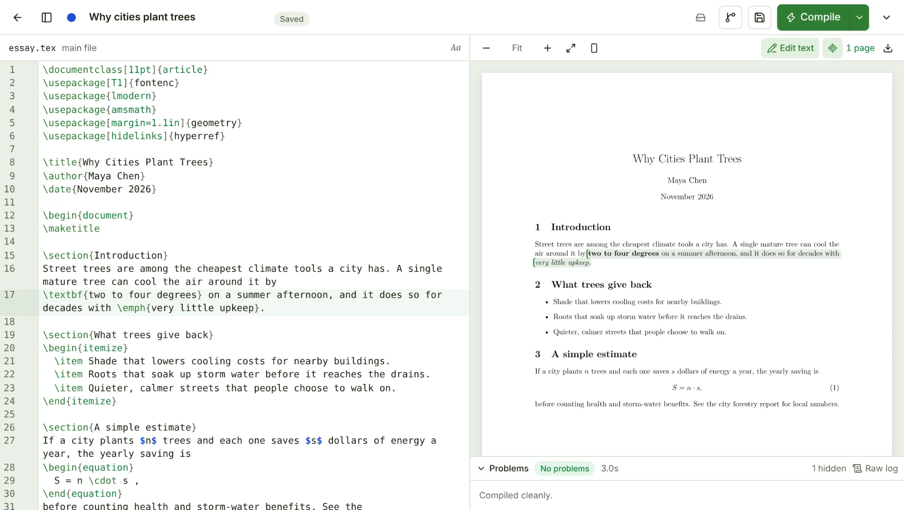

# TexChef

**A LaTeX editor that runs entirely in your browser.** Write essays, papers, letters and resumes; compile them to PDF
on your own device; keep everything in your browser and, if you like, your own Google Drive. There is no TexChef
server and no account.

Its own idea: **keep one master document and branch linked variants from it**: a resume per job, a paper per venue,
a letter per recipient. When the master changes, each variant can take the update without losing its own edits.



## What it does

- **Compiles in the browser.** TeX Live 2026 runs as WebAssembly ([texlyre-busytex](https://github.com/TeXlyre/texlyre-busytex)):
  pdfLaTeX, XeLaTeX, LuaLaTeX and BibTeX, with no compile server. Packages download once, the first time a document needs them.
- **Linked variants.** Build a variant by ticking sections, jobs and bullets, or by picking tags (`backend`, `ml`…),
  with a live PDF and page count. Later, **get updates** from the original (a 3‑way merge keeps your rewording) or
  **copy** a reworded bullet back to it. Documents can also be linked, unlinked or swapped after the fact.
- **Edit on the PDF.** Click a sentence in the PDF and change it as plain text; TexChef finds the LaTeX behind it,
  rewrites only what changed and keeps the formatting.
- **Visual mode.** A formatted view beside the code (headings, bold, lists, links; the preamble folded away), with a
  formatting bar and a font menu, without changing how the file is written.
- **Version history.** Every save is a numbered version you can restore, branch from, download or compare. A map
  shows how documents and versions relate.
- **Compare side by side.** Any two documents or versions, both editable, with per‑change copy arrows and the PDFs
  next to each other.
- **Readable problems.** Errors link to their line, common warnings get a plain explanation, and a document written
  for another engine gets a one‑click switch.
- **SyncTeX.** Double‑click the PDF to jump to the source; locate the cursor's line in the PDF.
- **Folders, previews, export and backup.** Nested folders, PDFs or LaTeX projects of a folder as a `.zip`, and a full
  backup with history that restores everything.
- **Upload what you have.** `.tex`, `.cls`, `.sty`, `.bib`, images, fonts, Overleaf `.zip` exports, and bundles of
  many projects.
- **AI agents (experimental, off by default).** An assistant you already use can read your documents from your Drive
  and leave proposed changes there, which you review edit by edit. TexChef never sends anything to an AI itself.
- **Phones, tablets and split screens**, and six colour themes in light and dark.

## Your files stay yours

- Documents live in your browser (IndexedDB). Nothing is uploaded unless you connect Google Drive.
- With Drive connected, TexChef uses the narrow `drive.file` permission: it can see only the files it created or that
  you pick. Your documents appear in a `TexChef/` folder as readable LaTeX and PDFs, with history in `TexChef/.texchef/`.
- Edits made offline or on two devices are never lost: TexChef merges them, or asks when it can't.

## Variants: how blocks work

Variants are built from blocks, marked with LaTeX comments so the compiler ignores them:

```tex
%% @block exp-acme tags=backend,lead
\rcEntry{Acme}{2022 -- Now}{Senior Engineer}{Remote}
\rcItemListStart
  %% @block acme-k8s tags=infra
  \rcItem{Migrated 40 services to Kubernetes.}
  %% @end
\rcItemListEnd
%% @end
```

- Blocks nest and need ids that are unique in the project. `tags=` is optional; `title="…"` overrides the label.
- A variant keeps a *recipe*: the blocks you ticked, or the tags you picked, with per‑block overrides.
- **Get updates** re‑applies the recipe to the original's old and new versions and 3‑way merges the difference into
  the variant. Blocks that are new in the original are offered; conflicts are shown side by side.
- **Copy to original** copies one block (matched by id) back into the original as a new version there.
- Already have a resume? Upload it and press **Auto‑mark** in the Blocks panel to wrap its sections, entries and
  bullets in blocks.

The code calls the original the *parent*, getting updates *pull* and copying back *push*.

## Run it locally

Requires Node 20+ and pnpm.

```bash
pnpm install
```

```bash
pnpm tex:assets   # the TeX engine and TeX Live data: about 520 MB to download, 700 MB on disk, into tex-assets/
```

```bash
pnpm dev          # http://localhost:5173
```

Without Google settings the app runs in **Local only** mode: fully working, with data kept in that browser.

| Command | What it does |
| --- | --- |
| `pnpm test` | Unit tests |
| `pnpm typecheck` | TypeScript |
| `pnpm build` | Production build into `dist/` (about 3 MB, without the TeX engine) |
| `pnpm build:pages` | Build plus the gzipped, split TeX engine in `dist/core/busytex` (what gets deployed) |
| `pnpm e2e http://localhost:5173` | End‑to‑end browser checks (Playwright) against a running dev server |
| `pnpm e2e:engines http://localhost:5173` | Engine coverage: XeLaTeX, LuaLaTeX, BibTeX, TikZ, moderncv… |
| `node e2e/responsive.mjs http://localhost:5173` | Layout checks at phone, tablet and desktop sizes |
| `pnpm shots http://localhost:5173` | Retake the help and landing screenshots from the running app |

## Host your own copy

TexChef is a static site: any static host works. These steps use Cloudflare's free plan.

### 1. Settings

Copy `.env.example` to `.env` for local use; on a host, set the same names as **build** variables (Vite bakes them in).

| Variable | What it's for |
| --- | --- |
| `VITE_GOOGLE_CLIENT_ID`, `VITE_GOOGLE_API_KEY`, `VITE_GOOGLE_APP_ID` | Google Drive sync and the Drive file picker (see below). Leave empty for Local only. |
| `VITE_LEGAL_OPERATOR`, `VITE_LEGAL_CONTACT`, `VITE_LEGAL_JURISDICTION` | Who runs your copy, how to reach you, and the governing law, shown on `/privacy` and `/terms`. |
| `VITE_SITE_URL` | Your copy's address, shown on those pages (defaults to the address in the browser). |
| `VITE_SOURCE_URL` | Where your copy's source code is published. If you changed the code, point this at your fork. |

The Privacy Policy and Terms in `src/legal/` describe this app's actual data flows. They are not legal advice; have
them reviewed if the stakes matter.

### 2. Google Drive (optional)

TexChef signs in with the Google Identity Services token flow from the browser: no backend and no client secret.

1. In the [Google Cloud console](https://console.cloud.google.com/), create a project and note its **project number**
   (that is `VITE_GOOGLE_APP_ID`).
2. APIs & Services → Library: enable **Google Drive API** and **Google Picker API**.
3. **Google Auth Platform:**
   - **Branding:** your app name, support email, home page `https://<your-domain>`, privacy policy
     `https://<your-domain>/privacy`, terms `https://<your-domain>/terms`, and your domain under **Authorized domains**.
   - **Audience:** External; in **Testing**, add up to 100 test users.
   - **Data Access:** add the scope `.../auth/drive.file`. It is non‑sensitive, so Testing needs no verification.
   - **Clients:** create a **Web application** client. Authorized JavaScript origins: `https://<your-domain>` and
     `http://localhost:5173`. No redirect URIs. Copy the **Client ID**.
4. **API key** (for the picker only): Credentials → Create credentials → API key. Restrict it to the websites
   `https://<your-domain>/*`, `http://localhost:5173/*` **and `https://docs.google.com/*`** (the picker runs there;
   without it Google says “The API developer key is invalid”), and to the **Google Picker API**.

### 3. Deploy

The TeX engine's largest files are bigger than Cloudflare's 25 MiB limit, so `scripts/shard-tex-assets.mjs` gzips and
splits them, and a small worker wrapper (`scripts/busytex-worker-shim.js`) joins them again in the browser.

**From a Git repository** (Workers & Pages → Create → Import a repository):

1. Build command `pnpm cf:build`; deploy command `npx wrangler deploy`. `wrangler.toml` serves `dist/` as static
   assets with a single‑page‑app fallback.
2. Settings → Build → **Variables and secrets**: the variables from step 1.
3. Settings → Domains & Routes → add your **custom domain**, and add it to your Google client's origins and the API
   key's websites.

**Or from your machine:**

```bash
pnpm tex:assets && pnpm build:pages
```

```bash
npx wrangler deploy
```

Engine parts are named by content hash and cached for a year, so returning visitors download none of the large files
and a new engine version never mixes with the old one. To check the production build locally, run `pnpm build:pages`,
then `pnpm preview`.

## Project layout

```
src/
  core/        versions: model, repository (commits, working copies, merge base), 3-way text merge
  blocks/      block parser, recipe filter, auto-mark, block copy and compare
  variants/    create variants, get updates (pull), copy to original (push), linking
  pdfedit/     editing on the PDF: LaTeX to plain text, PDF text to source, write-back
  compile/     BusyTeX wrapper, TeX bundle planner, log parser, pdf.js helpers
  storage/     IndexedDB (Dexie), the sync engine, Google Drive and in-memory providers
  features/    home page, editor, map, compare, history, sync, settings, agents, import and export
  help/        the in-app guide
  templates/   starting documents
  legal/       Privacy Policy and Terms
ideas/         static landing page experiments
brand/         logo sources
scripts/       engine sharding, the worker wrapper, screenshots, deploy helper
e2e/           Playwright end-to-end checks
```

Patch notes live in `src/app/changelog.ts` and appear on the **What's new** page in the guide.

## Limits

- The first compile downloads a 93 MB core bundle; documents using packages outside it trigger larger one‑time
  downloads. A package that isn't in TeX Live 2026 can be uploaded into the project as a `.sty` file.
- No real‑time co‑editing.
- Google Drive is the only cloud storage so far.

## Feedback

Bug reports and ideas are welcome in [Issues](https://github.com/lightkuro/TexChef/issues).

## Licence

TexChef is free software: you can redistribute it and/or modify it under the terms of the
[GNU General Public License](LICENSE), version 3 or (at your option) any later version. It comes with no warranty.

If you host a copy for others, offer them its source code: link your fork with `VITE_SOURCE_URL` (the footer and the
Terms page link to it).

TexChef includes or downloads software under other free licences:

- **TeXlyre BusyTeX** (the TeX engine), GNU AGPL‑3.0, based on [BusyTeX](https://github.com/busytex/busytex) (MIT).
  Its terms apply to hosted copies too, which is another reason to keep your copy's source public.
- **TeX Live**, downloaded at build time and not stored in this repository: various free licences, including the GPL
  and the LaTeX Project Public License.
- **PDF.js** (Apache 2.0), **Dexie** (Apache 2.0) and other libraries under MIT and ISC licences; see `package.json`.
- The **Computer Modern** web fonts in `ideas/fonts/` are under the SIL Open Font License (`ideas/fonts/OFL.txt`).

The licence covers the code. If you run a modified copy publicly, please give it your own name and logo, so people
don't mistake it for this one.

Made by [kurolight.dev](https://kurolight.dev).
